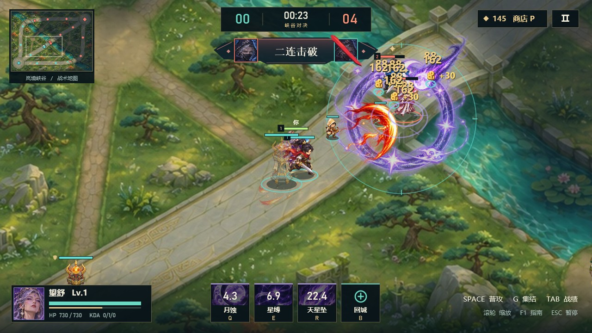

<p align="center">
  
</p>

<h1 align="center">岚境 · RIFTWARD</h1>

<p align="center">用纯 C11 打造的 Windows 单机 5v5 推塔游戏</p>



《岚境》是一款以 C11 编写的 Windows 单机 MOBA 游戏。你控制一名英雄，与四名 AI 队友并肩作战，对抗五名 AI 英雄，通过清兵、成长、推塔，最终摧毁敌方水晶获胜。

> 这是独立制作的原创项目，不是《王者荣耀》官方游戏。

## 游戏展示

### 英雄选择与动态立绘


五名英雄拥有不同定位、技能和动态场景。[观看动态立绘演示（25 秒）](https://raw.githubusercontent.com/Ilikectrlmusic/honor-of-c/main/docs/living-portraits.mp4)。

### 战斗与动作


三路兵线、野区营地、防御塔、战争迷雾，以及可集结的 AI 队友，共同构成完整的对局。

[观看战场反馈与音效（29 秒）](https://raw.githubusercontent.com/Ilikectrlmusic/honor-of-c/main/docs/battle-feedback.mp4) · [观看出生、阵亡与复活（13 秒）](https://raw.githubusercontent.com/Ilikectrlmusic/honor-of-c/main/docs/observer.mp4)

### 开场与胜负结算

选将后展示双方英雄卡牌；摧毁水晶时有破碎动画、胜负徽章和战绩结算。

[观看入场和结算演示（18 秒）](https://raw.githubusercontent.com/Ilikectrlmusic/honor-of-c/main/docs/arena-ceremonies.mp4)

## 游戏特色

- **五名原创英雄**：战士烬锋、射手青翎、法师望舒、坦克镇岳和刺客夜渡，各自拥有三个技能。
- **完整 5v5 对局**：四名 AI 队友、五名 AI 敌人，支持三档敌方难度。
- **MOBA 核心玩法**：三路推进、清兵推塔、野怪、经济装备、复活与胜负判定。
- **动态演出和音效**：英雄动作、技能特效、击杀播报、原创配乐和水晶结算动画。
- **完全离线**：使用 Windows 原生图形与音频接口，无需账号、服务器或游戏引擎。

## 基本操作

| 按键 | 操作 |
| --- | --- |
| WASD | 移动 |
| 鼠标左键 / 右键 | 攻击移动、选定目标 / 移动与追击 |
| 空格 | 按住普攻与索敌 |
| Q / E / R | 释放技能 |
| B | 回城 |
| P | 打开商店 |
| G | 呼叫队友集结 |
| Tab / Esc | 战绩 / 暂停 |
| F1 | 战场指南 |

第一次游玩推荐选择 **青翎** 和 **入门** 难度，跟随兵线推进，利用小兵保护拆除防御塔，最后攻击敌方水晶。

## 运行与构建

**系统：** 64 位 Windows 10 / 11。

目前需要从源码编译。安装 **MinGW-w64 GCC 和 windres**（推荐 MSYS2 UCRT64），将工具链的 `bin` 目录加入 `PATH`，然后在项目目录运行：

```bat
build.bat
```

构建后运行 `Riftward.exe` 即可。图片和音频均嵌入可执行文件，复制 EXE 到另一台兼容的 Windows 电脑也能运行。

## 开发与测试

项目以 **C11 + Win32 + Direct2D / DirectWrite / WIC / WinMM** 实现，不依赖商业游戏引擎。世界模拟、AI、渲染、动画和音频均保存在 `src/` 中。

运行 `test.bat` 可以执行规则测试、重新构建并生成渲染截图。更多播报设计与音效说明见 [播报文档](docs/announcer.md)。

