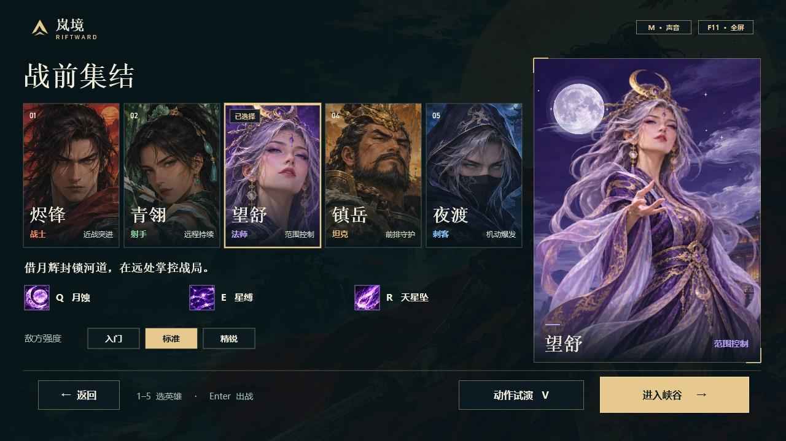

# 岚境 · RIFTWARD

一个用 **C11** 编写的 Windows 单机 5v5 推塔游戏。你操控一名英雄，四名队友和五名对手都由本地 AI 操控。采用原创英雄、地图与美术，不是《王者荣耀》官方客户端，也不需要账号、游戏服务器或网络连接。

[观看首页和五名英雄的动态立绘（25 秒游戏画面）](docs/living-portraits.mp4)。首页的山水与剑客是两张独立的图：山水完整且固定，头发、衣摆摆开时，露出来的是背后的山水。选将时点左侧卡片或按 **1–5 / ← / →** 切换：烬锋身后有炉火和余烬，青翎身后是摇动的竹枝，望舒有月轮、星光和流星，镇岳有城头金旗，夜渡有穿过薄雾的渡鸦。场景动画都在人物身后，不覆盖脸或操作区。

## 开始游戏

先按下方说明从源码构建，然后在 **64 位 Windows 10 / 11** 上双击生成的 **Riftward.exe**。美术资源已经嵌入程序，可只复制这一个文件到另一台电脑，不需要安装 GCC、Python 或游戏引擎。

1. 点击 **选择英雄**，在五名英雄和三档敌方强度中选择，再点 **进入峡谷**。第一次可选「青翎」和「入门」：远程普攻比较容易掌握距离。
2. 跟随一条路的小兵前进。用 **WASD** 走位，把鼠标放在敌人身上按 **Q / E / R**；按住 **空格 + WASD** 可边走边普攻。也可右键锁定敌人，再用 WASD 绕行或后撤：射程内继续攻击，手动走位期间不会被自动追击拉回。停在原地也会普攻射程内的敌军。
3. 清兵、参与击败或推塔获取金币，按 **P** 买装备。有同路小兵进塔时再拆塔：**同一路外塔 → 内塔 → 敌方水晶**。击败数多不等于胜利。
4. 残血按 **B** 回城；想组织进攻，指向战场或小地图上的地点按 **G**。最多两名可响应的 AI 队友会向该处集结。

## 键鼠操作

| 输入 | 动作 |
|---|---|
| WASD | 存活时走位；阵亡时移动观战镜头，也可点小地图跳转。复活自动回到自己身上 |
| 右键地面 / 敌人 | 绕路移动 / 追击并普攻指定目标 |
| 左键地面 / 敌人 | 攻击移动 / 锁定目标；左右键也能在小地图上下达移动指令 |
| 空格（按住） | 主动索敌普攻；附近有目标时向攻击距离靠近 |
| Q / E / R | 朝鼠标方向或位置快速施放三个技能，不耗蓝，有独立冷却 |
| 左键技能格 → 左键战场 | 先显示范围再施放；右键或 Esc 取消瞄准 |
| B | 引导 4 秒回城；移动、施法、攻击指令、受击会中断 |
| G | 向指针地点发集结信号：持续 12 秒，冷却 22 秒 |
| P / Tab（按住） / Esc | 商店 / 双方战绩 / 暂停。单机面板打开时模拟冻结 |
| 滚轮 / F11 / M / F1 | 镜头缩放 / 窗口与全屏切换 / 静音 / 战场指南 |

选将时可用 **1–5** 或左右方向键切换，**Enter** 确认。切出游戏会自动暂停。退出当前对局会丢失本局进度。

### 入场与结算

[观看选将声音、双方卡牌 VS、水晶碎裂和两种结算徽章（18 秒有声演示）](docs/arena-ceremonies.mp4)。

- 点击卡片、按数字键或左右方向键切换英雄时，会听到对应英雄的短音；重复点击当前英雄不会重复响，M 可静音。
- 点击「进入峡谷」或按 Enter 后，我方五张卡在上、敌方五张卡在下。上排第一张是你，金光沿卡框流动。其余卡位每局打乱，但卡上的英雄就是本局实际出战的十人。约 3.8 秒后进入战场，才开始计时、播报和出兵。
- 水晶被击破后，镜头切到被摧毁的一方，依次呈现裂纹、晶体爆裂、冲击波和碎片落地。蓝金色「胜利 / VICTORY」或暗红色「失败 / DEFEAT」徽章随后出现。看到「点击屏幕继续」后，左键、Enter 或空格可查看战绩，再选择返回首页或重新选将。

### 动作试演

在选将页按 **V** 进入试演，按 **1–5** 切换英雄、**R** 重放大招、**Esc** 返回。上方的陪练场使用实战的模拟和渲染，下方每组小兵左侧走跑、右侧攻击，可以直接比较动作。试演不会消耗正式对局的冷却或金币。

英雄、枪盾兵、弩兵、攻城车与山灵使用逐帧动作，而不是上下移动立绘。移动时，步态与实际走过的距离同步；玩家持续按住 WASD 顶住路界或障碍物时，英雄会原地踏步奔跑，松键后停下。攻击按起手、出招、收势播放，箭矢和伤害在释放帧才产生。五个大招分别使用行进的火刃、落羽箭阵、坠星月轨、岩刺震地和残影交叉斩。

### 战场反馈与声音

[观看 29 秒有声演示（MP4）](docs/battle-feedback.mp4) · [试听首页配乐《云起列阵》](assets/audio/banners.wav)

- **山灵重拳可以躲。** 靠近营地或攻击山灵会引起仇恨。它停步举拳，用琥珀色地圈缓慢追瞄目标约 0.32 秒；圈变成朱红色就已锁定。落拳前还有约 0.42 秒可以横移出圈。伤害只发生在真实落点，空拳也有碎岩和闷响。
- **泉水蓝光。** 初次登场、完成回城、复活时，蓝色光柱和法阵会一直跟着该英雄的脚下，即使立刻走动也不会留在泉水。双方人机遵循同样规则；残血人机在安全且回城比步行更快时也会引导回城。引导被打断不会产生抵达光柱。
- **阵亡观战。** 地形、单位和场景特效变暗，金币数字、血条、小地图、击杀与集合播报保持原亮度。WASD 移动的是镜头，不会揭开战争迷雾。复活恢复亮度和跟随；观战时按住的方向键要松开重按才会让英雄走动。[观看出生光柱、阵亡移镜和复活演示（13 秒）](docs/observer.mp4)。
- **击杀与集合。** 计分板正下方显示击败者、被击败者的头像；朱红色粗笔从左上向右下划过败者，两端越出头像边框。首个英雄击杀有「第一滴血」专属横幅，连续击杀依次展示；集合信号可同时显示。下方的技能提示、回城进度与短消息按实际文字宽度排版。
- **金币反馈。** 补刀、击败山灵等真实赏金会从倒下的位置爆开、旋转并飞向获奖英雄。玩家的金额单独标为金色；蹭线收益使用较小的金币效果，自动发薪不播动画。
- **声音全离线。** 首页使用原创 6/8 拍立体声配乐《云起列阵》，以弹拨、箫声、弦乐和战鼓铺陈。开局先欢迎，第一波兵线在五秒提醒结束倒数时出发；倒计时、全军出击、First Blood、集合、双方英雄击败、防御塔失守/摧毁和胜负均有内嵌语音。语音不互相叠读，播报期间会压低其他声音。按 M 可一键静音。配乐与播报均非官方录音。[查看 34 条语音的场景分类、击杀试听与参考资料](docs/announcer.md)。欢迎、五秒提醒和全军出击只播放声音，不占顶部消息栏。

## 五名英雄

| 英雄 | 定位 | Q | E | R |
|---|---|---|---|---|
| 烬锋 | 突进战士 | 掠火：沿途斩击 | 回锋：范围横扫并回血 | 焚天斩：穿透剑气并击晕 |
| 青翎 | 机动射手 | 穿林箭：穿透直线目标 | 逐风：翻滚、攻速与移速增益 | 流星箭雨：区域打击与减速 |
| 望舒 | 控制法师 | 月蚀：碰撞爆裂 | 星缚：短延迟区域控制 | 天星坠：预警后高伤坠星 |
| 镇岳 | 前排坦克 | 撼地：近身群体减速 | 金城：为附近友方英雄加盾 | 山崩：跃进并范围击晕 |
| 夜渡 | 爆发刺客 | 瞬影：快速穿身斩 | 寒刃：飞刃减速 | 断夜：突袭，对残血目标增伤 |

## 战场规则

- **三条兵线**：每边六座塔、一座水晶。前置塔未破时，后方建筑有封印；没有敌方兵线接近时，建筑受到的伤害大幅降低。塔优先清兵，但在塔下伤害守方英雄会吸引塔火。
- **兵线与野区**：开场约 2 秒播报五秒提醒，第 7 秒第一波兵线出发，随后通常每 18 秒出兵，每三波增加攻城车；后期出兵加快。四个营地的山灵可以追击、脱战与重生；击败者得到金币、治疗以及 35 秒攻击增益。
- **战争迷雾**：友方防御塔和基地水晶都有独立的持续视野，不需要附近有英雄或小兵。塔被推掉时，其提供的视野立即消失；如果另一座塔或友军仍能看见那里，就保持明亮。主画面与小地图共用这份视野。
- **英雄成长**：补刀、附近小兵阵亡、击败、助攻及推塔带来不同收益。等级提升增加生命和攻击；三件装备各有四阶，金钱足够即可购买，AI 遵循相同购买规则。
- **本地人机**：会分路、施法、撤回泉水、跟兵进塔；远程英雄会拉开距离，刺客会争夺野怪。玩家可用集结指令改变队友的推进方向。难度调整敌方英雄基础攻防强度。

## 从源码构建

需要 Windows 上的 **MinGW-w64 GCC + windres**（开发时使用 MSYS2 UCRT64），将其 bin 目录加入 PATH，然后在项目目录执行：

~~~bat
build.bat
~~~

游戏运行时只使用 Windows 自带的 Win32、Direct2D、DirectWrite、WIC 和 WinMM。图片由 WIC 解码；配乐和播报以 PCM 资源内嵌，与实时合成的战斗音效通过 WinMM 立体声混音。正常构建和运行均不需要 Python、语音包、FFmpeg 或音频插件。

| 文件 | 职责 |
|---|---|
| src/game.c、src/game.h | 不依赖窗口的世界模拟、寻路、仇恨、视野、技能、经济、胜负 |
| src/ui.c | 主界面、选将、相机、战场、HUD、战绩、键鼠映射 |
| src/animation.c、src/motion_data.h | 动作帧选择、脚底与髋部定位、阵营配色、逐层绘制五种大招 |
| src/living.c | 首页剑客和五名选将立绘的呼吸、眼睑、头发与衣料形变；与战斗模拟独立 |
| src/presentation.c | 双方卡牌入场、金色流边、水晶碎裂、胜负徽章 |
| src/domain.c | 选将时位于立绘背后的五套动态场景 |
| src/draw.c | Direct2D 渲染、中文排版、资源解码、离屏绘制 |
| src/audio.c | 战斗音效合成、立体声配乐、播报优先级、音量避让与静音 |
| src/main.c | Win32 窗口和消息循环、固定 60 Hz 模拟、全屏和自检入口 |
| assets/、src/resources.rc | 嵌入可执行文件的原创图像、图标及音频 |

## 可重复验证

运行 **test.bat**。它会运行规则测试、重新构建游戏，并把真实渲染截图输出到 **build/gallery/**。

- 验证五个职业的独立阵容、全部 15 个技能的实际效果与冷却、前置塔封印、装备价格与叠加上限、地图寻路、回城中断与完成、视野与队友集结。
- 对三种难度运行固定种子的完整 AI 对局，要求实际摧毁水晶、确认胜方，不能仅靠超时判胜。其中一场使用与交互版相同的 60 Hz 步长。
- 追踪双方人机和玩家的光柱位置；移除所有英雄与小兵后单测塔和水晶的视野，并验证拆塔与视野重叠。在实际 Direct2D 帧中比较人物摆动前后的背景、五套没有人物的动态场景，以及阵亡遮罩前后的金币、击杀与集合提示。
- 动作专项测试验证走停、撞墙、八种普攻的起手与命中时刻、死亡或控制中断、目标失效，以及五个大招的起手和落点事件。离屏检查同时抓取五种大招试演及七个常规界面。
- 另可执行 **Riftward.exe --window-test** 做隐藏原生窗口自检。可选的 **Riftward.exe --motion-capture build/motion-capture** 输出用于制作动图的实际试演帧；构建和正常游戏均不依赖这些帧。

新增的反馈专项会检查山灵的缓追瞄、锁点、走位闪避、控制取消；三种泉水抵达事件；真实赏金与金币特效的一致性；击杀横幅排队及集合语音。**Riftward.exe --audio-check** 还会验证全部内嵌音频、立体声循环、播报优先级与静音，无需声卡。
